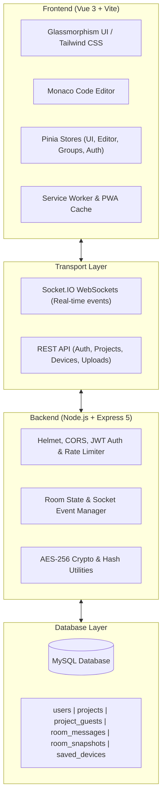

# ⚡ ShareSyntax

> **Real-time Collaborative Code Editor, Multi-File Workspace & Ephemeral Room Chat**

[](https://vuejs.org/)
[](https://vitejs.dev/)
[](https://nodejs.org/)
[](https://expressjs.com/)
[](https://socket.io/)
[](https://www.mysql.com/)
[](https://tailwindcss.com/)
[](https://web.dev/progressive-web-apps/)

---

## 📖 Overview

**ShareSyntax** is a modern, high-performance web platform designed for developers, pair programmers, educators, and teams who need instant, secure code collaboration without friction. It merges a full-featured Monaco editor workspace with real-time multi-peer synchronization, encrypted temporary room messaging, cloud snapshot history, and multi-device connection management.

Whether you need a quick pastebin alternative with live editing, an interactive interview environment, or a multi-file project workspace that syncs across devices, ShareSyntax provides a seamless glassmorphism dark-mode experience.

---

## ✨ Key Features

### 💻 Collaborative Monaco Code Editor
- **Full Monaco Engine**: Syntax highlighting, auto-completion, multi-cursor support, and language intelligence for dozens of languages (JS, TS, Python, HTML, CSS, C++, JSON, and more).
- **Multi-File & Folder Tree**: Create, rename, delete, and organize files and nested folders in a responsive explorer panel.
- **Real-Time Delta Sync**: Instant state and structure broadcasts powered by low-latency Socket.IO rooms.
- **Granular Permissions & Privacy**:
  - Mark individual files as private to the host.
  - Set read/write locks or hide specific nodes from individual users.
  - Host-level room toggles: enable or disable file creation, editing, deletion, or downloading.
- **One-Click Export**: Package the entire file tree into a `.zip` archive via JSZip for instant offline use.

### 💬 Ephemeral Room Chat & Quick Sharing
- **End-to-End Room Security**: AES-256 encrypted chat messages and room history.
- **Instant Pair & Quick Connect**:
  - 6-digit numeric room PINs for frictionless entry.
  - Interactive QR code generator and integrated camera scanner (`html5-qrcode`).
  - Shareable direct invite URLs (`/join/:roomId`).
- **Rich Message Streams**: Share code snippets, text notes, and file cards with copy-to-clipboard shortcuts.

### 🛡️ Host Governance & Room Controls
- **Host Privileges**: Lock rooms against new arrivals, kick troublesome guests, and configure permission policies dynamically.
- **Seamless Host Migration**: Automatic graceful failover if a host unexpectedly disconnects.
- **Reconnection Handling**: Graceful session reconnection timeouts to survive brief network interruptions.

### 💾 Project Persistence & History Snapshots
- **Auto-Snapshots**: File trees are automatically snapshotted on a debounced schedule and every 30 seconds of active editing.
- **User Accounts & JWT Auth**: Optional sign-in with bcrypt password encryption for saving projects permanently.
- **Project Dashboard**: View saved workspaces, inspect previous message logs, review file tree revisions, rename projects, and resume live rooms.
- **Saved Devices**: Track registered devices, platforms (web, mobile, desktop), and manage authorized pairings.

### 📱 Progressive Web App (PWA)
- **Installable Everywhere**: Install natively on Android, iOS, Windows, macOS, and Linux.
- **Workbox Optimization**: Pre-cached shell assets with auto-updating Service Workers for near-instant cold boots.

---

## 🏗️ System Architecture



---

## 🛠️ Tech Stack

| Category | Technology |
| :--- | :--- |
| **Frontend Framework** | [Vue 3](https://vuejs.org/) (Composition API, `<script setup>`) |
| **State Management** | [Pinia](https://pinia.vuejs.org/) |
| **Routing** | [Vue Router 4](https://router.vuejs.org/) |
| **Styling & Icons** | [Tailwind CSS v4](https://tailwindcss.com/), [Lucide Vue Next](https://lucide.dev/) |
| **Code Editor** | [Monaco Editor](https://microsoft.github.io/monaco-editor/) via `@monaco-editor/loader` |
| **Bundler & Tooling** | [Vite 5](https://vitejs.dev/), [vite-plugin-pwa](https://vite-pwa-org.netlify.app/) |
| **Backend Framework** | [Node.js](https://nodejs.org/) & [Express 5](https://expressjs.com/) |
| **Real-time Protocol** | [Socket.IO 4](https://socket.io/) (with `perMessageDeflate`) |
| **Database** | [MySQL 8+](https://www.mysql.com/) via `mysql2/promise` (connection pooling) |
| **Security & Crypto** | `jsonwebtoken`, `bcryptjs`, Node.js native `crypto` (AES-256), `helmet` |

---

## 📁 Repository Structure

```
ShareSyntax/
├── client/                     # Frontend Application (Vue 3 + Vite)
│   ├── public/                 # Static assets, PWA manifest icons, robots.txt
│   ├── src/
│   │   ├── assets/             # Branding, graphics, and SVGs
│   │   ├── components/         # Modular Vue components
│   │   │   ├── base/           # Base UI primitives (GlassCard, BaseButton, BaseInput)
│   │   │   ├── editor/         # MonacoEditor, FileTree, modals
│   │   │   ├── layouts/        # EditorLayout, ChatLayout, DashboardLayout, NearbyLayout
│   │   │   ├── modals/         # HostRoomModal, JoinModal, ConnectModal
│   │   │   └── shared/         # UserAvatar, FileCard
│   │   ├── router/             # Vue Router navigation & route guards
│   │   ├── stores/             # Pinia state stores (auth, editor, groups, devices, ui)
│   │   ├── utils/              # API clients, avatar generator
│   │   ├── views/              # Home.vue, LandingView.vue, AuthView.vue, DashboardView.vue
│   │   ├── App.vue             # Root application component
│   │   ├── main.js             # Client bootstrap
│   │   └── style.css           # Global Tailwind CSS definitions
│   ├── .env.example            # Client environment template
│   ├── package.json            # Client dependencies and scripts
│   ├── tailwind.config.js      # Tailwind design configuration
│   └── vite.config.js          # Vite plugins, PWA, and build configs
├── server/                     # Backend Application (Node.js + Express)
│   ├── src/
│   │   ├── config/             # Database connection pool & auto-migration (`db.js`)
│   │   ├── middleware/         # JWT protection & request authentication
│   │   ├── models/             # Project, User, and RoomHistory models
│   │   ├── routes/             # REST API endpoints (auth, projects, devices, upload)
│   │   ├── socket/             # Real-time room manager & event handlers (`handler.js`)
│   │   ├── utils/              # AES-256 encryption/decryption helpers
│   │   └── index.js            # Express server entry point & Socket.IO initialization
│   ├── uploads/                # Directory for temporary file uploads
│   ├── .env.example            # Server environment template
│   └── package.json            # Server dependencies and scripts
├── .gitignore                  # Comprehensive gitignore for security and hygiene
└── README.md                   # Project documentation
```

---

## 🚀 Getting Started

### Prerequisites
Make sure you have installed:
- **Node.js** (v18.0.0 or higher) & **npm**
- **MySQL** (v8.0+ or MariaDB 10.5+)

---

### 1. Database Setup
Ensure MySQL is running on your machine:
```bash
# macOS (Homebrew)
brew services start mysql

# Ubuntu/Debian
sudo systemctl start mysql
```
*Note: The server will automatically create the `sharesyntax` database and all required tables upon starting if they do not exist.*

---

### 2. Backend Setup
1. Open a terminal and navigate to the `server` directory:
   ```bash
   cd server
   ```
2. Install dependencies:
   ```bash
   npm install
   ```
3. Create your environment configuration:
   ```bash
   cp .env.example .env
   ```
4. Configure your `.env` credentials:
   ```env
   PORT=3000
   DB_HOST=localhost
   DB_USER=root
   DB_PASSWORD=your_password
   DB_NAME=sharesyntax
   JWT_SECRET=your_super_secret_jwt_key
   ROOM_HISTORY_SECRET=Your32CharacterSecretEncryptionKey!
   ```
5. Start the backend server:
   ```bash
   # Development mode (with auto-reload)
   npm run dev

   # Production mode
   npm start
   ```
The backend will run on `http://localhost:3000`.

---

### 3. Frontend Setup
1. In a new terminal window, navigate to the `client` directory:
   ```bash
   cd client
   ```
2. Install dependencies:
   ```bash
   npm install
   ```
3. Create your environment configuration:
   ```bash
   cp .env.example .env
   ```
4. Verify your `.env` values:
   ```env
   VITE_SOCKET_URL=http://localhost:3000
   VITE_API_URL=http://localhost:3000
   ```
5. Start the development server:
   ```bash
   npm run dev
   ```
The client will be accessible at `http://localhost:5173`.

---

## 🔌 Socket.IO Event Reference

| Event Name | Direction | Payload | Description |
| :--- | :--- | :--- | :--- |
| `join_group` | Client ➔ Server | `{ groupId, user, isCreating }` | Join or instantiate a room session |
| `leave_group` | Client ➔ Server | `{ groupId, user }` | Clean exit from active room |
| `send_message` | Client ➔ Server | `{ groupId, message }` | Broadcast AES-encrypted room message |
| `request_room_pin` | Client ➔ Server | `{ groupId }` | Generates a 6-digit quick-join PIN |
| `editor:sync_state` | Client ➔ Server | `{ groupId, fileTree }` | Propagate full workspace structure to peers |
| `editor:file_update` | Client ➔ Server | `{ groupId, fileId, content }` | Broadcast live code change in open file |
| `editor:structure_update` | Client ➔ Server | `{ groupId, action, payload }` | Create, rename, or delete file/directory |
| `editor:save_snapshot` | Client ➔ Server | `{ groupId, fileTree }` | Persist snapshot to database storage |
| `admin:lock_room` | Client ➔ Server | `{ groupId, isLocked }` | Restrict room against new entrants |
| `admin:kick_user` | Client ➔ Server | `{ groupId, targetUserId }` | Forcefully remove a member from room |
| `admin:update_permissions`| Client ➔ Server | `{ groupId, permissions }` | Change global editing/creation rights |

---

## 🔒 Security & Privacy

- **No Secrets in Source Control**: Sensitive database credentials, JWT secrets, and encryption keys are strictly read from `.env` files and omitted from version control.
- **Input Sanitization & Rate Limiting**: Socket payload length caps and per-socket event throttling prevent spamming and denial-of-service abuse.
- **Node Privacy Isolation**: Files flagged as `isPrivate: true` by the host are filtered out on the server before transmitting file trees to guest peers.

---

## 🤝 Contributing

Contributions, bug reports, and suggestions are welcome!
1. Fork the Project
2. Create your Feature Branch (`git checkout -b feature/AmazingFeature`)
3. Commit your Changes (`git commit -m 'feat: Add AmazingFeature'`)
4. Push to the Branch (`git push origin feature/AmazingFeature`)
5. Open a Pull Request

---

## 📄 License

This project is licensed under the [ISC License](LICENSE).
